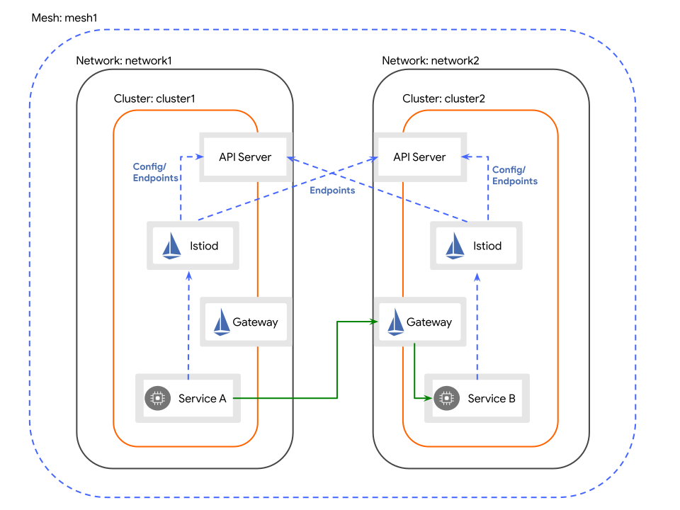

# Istio Ambient Multi-Cluster Mesh

Istio Ambient Multi-Cluster mesh PoC using two local Kind clusters.<br />
Mesh properties:
- [Multi-primary](https://istio.io/latest/docs/ops/deployment/deployment-models/#control-plane-models)
- [Multi-network](https://istio.io/latest/docs/ops/deployment/deployment-models/#multiple-networks)
- Single [Trust-domain](https://istio.io/latest/docs/ops/deployment/deployment-models/#trust-within-a-mesh)

The PoC consists of two clusters, `ecom-cloud` and `ecom-onprem`, each with their own Istio control plane, communication between the clusters happens via dedicated east-west gateways.

## Architecture



## Local Development

```
# run cloud and onprem cluster
task cluster:clusters-up

# install Gateway API into both clusters
task istio:install-gateway-api-all

# install Istio in both clusters (base, shared root CA + per-cluster cacerts, istiod, CNI, ztunnel)
task istio:install-istio-all

# start cloud-provider-kind in a SEPARATE terminal and keep it running, it assigns
# the LoadBalancer IP of the east-west gateways
sudo cloud-provider-kind --enable-lb-port-mapping=false

# install east-west gateway in both clusters
task istio:install-eastwest-gateway-all

# install ingress gateway in both clusters (NodePort 30080, reachable on localhost:8080 - cloud / localhost:18080 - onprem)
task istio:install-ingress-gateway-all

# create remote secrets (cross-cluster service discovery)
task remote:create-remote-secrets-all

# delete Gateway API from both clusters
task istio:delete-gateway-api-all

# cleanup clusters
task cluster:clusters-down
```

## Samples

### Hello World

```
# deploy helloworld app in both clusters
task samples:helloworld-all

# call helloworld through the ingress gateways, traffic is load balanced across clusters because the option AMBIENT_ENABLE_MULTI_NETWORK_INGRESS is set to "true"
curl localhost:8080/hello
curl localhost:18080/hello

# deploy curl app in both clusters
task samples:curl-all

# verify app traffic is load balanced across both clusters
kubectl exec --context="kind-ecom-cloud" -n curl -c curl \
    "$(kubectl get pod --context="kind-ecom-cloud" -n curl -l \
    app=curl -o jsonpath='{.items[0].metadata.name}')" \
    -- curl -sS helloworld.helloworld:5000/hello
kubectl exec --context="kind-ecom-onprem" -n curl -c curl \
    "$(kubectl get pod --context="kind-ecom-onprem" -n curl -l \
    app=curl -o jsonpath='{.items[0].metadata.name}')" \
    -- curl -sS helloworld.helloworld:5000/hello
```

## Lessons Learned

- `cloud-provider-kind` < v0.12.0 on macOS publishes every LoadBalancer port on the host, so the second east-west gateway (same port `15008`) never gets an IP. Use v0.12.0+ and run it with `--enable-lb-port-mapping=false`; clusters reach each other over the docker network
- Known limitations are listed here, https://istio.io/latest/docs/ambient/install/multicluster/#known-limitations
- The `istio-reader-service-account` service account can be used for cross-cluster service discovery
- Services that should be accessed from other clusters must be labeled with `istio.io/global: "true"` 
- In ambient mode, istiod builds the remote network gateway from the peer's east-west Gateway's status.addresses. It does not read spec.addresses for managed gateways
- For a managed Gateway, status.addresses comes from the Service: the external addresses if any exist, otherwise the ClusterIP and hostname. A NodePort Service has no external address by default, so the ClusterIP is reported
- pilot-agent environment variable `AMBIENT_ENABLE_MULTI_NETWORK_INGRESS`, If true and AMBIENT_ENABLE_MULTI_NETWORK is also true, it will enable ingress gateways to route requests to clusters on remote networks while by default ingress gateways will keep traffic local
- Traffic entering the ingress gateway stays within the local cluster when `AMBIENT_ENABLE_MULTI_NETWORK_INGRESS` is "false" (the default). Remote endpoints are not offered to the gateway at all, so there is also no failover to the other cluster. To use remote endpoints, set the flag to "true"; to prefer local endpoints with failover, additionally configure locality failover

## References
- https://istio.io/latest/docs/ops/deployment/deployment-models/
- https://istio.io/latest/docs/ambient/install/multicluster/
- https://istio.io/latest/docs/reference/commands/pilot-agent/